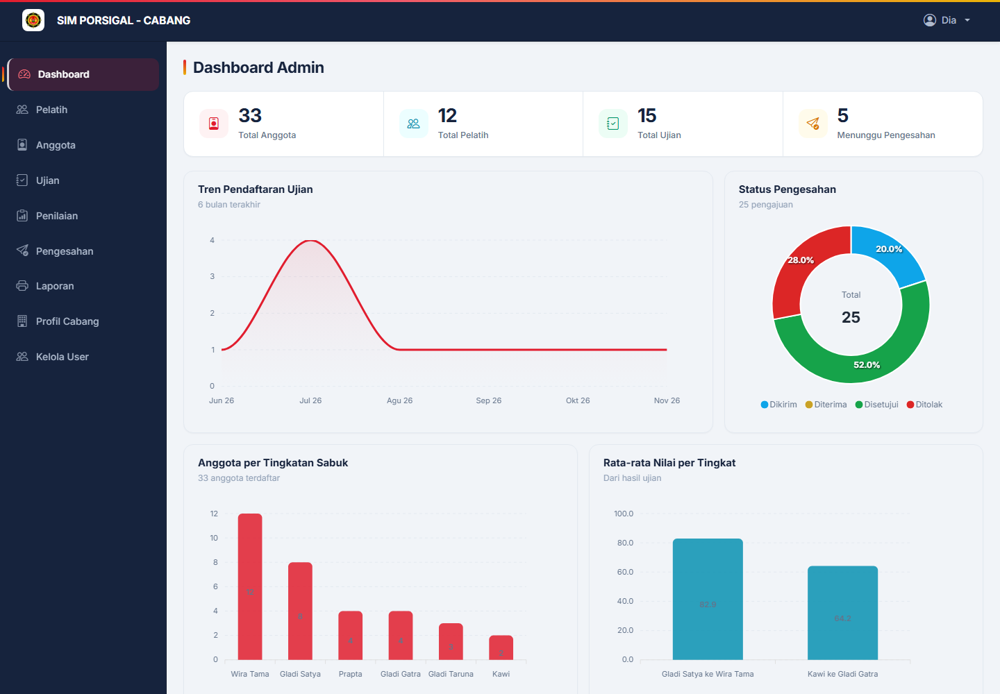
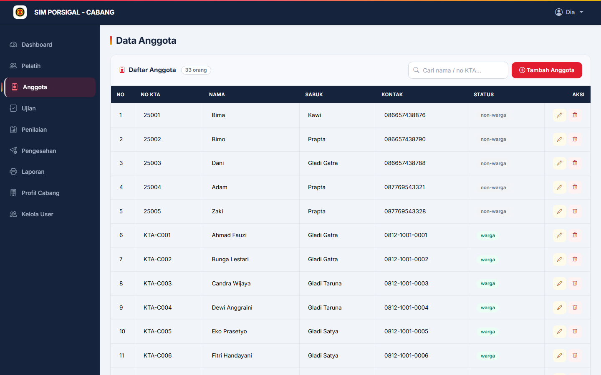
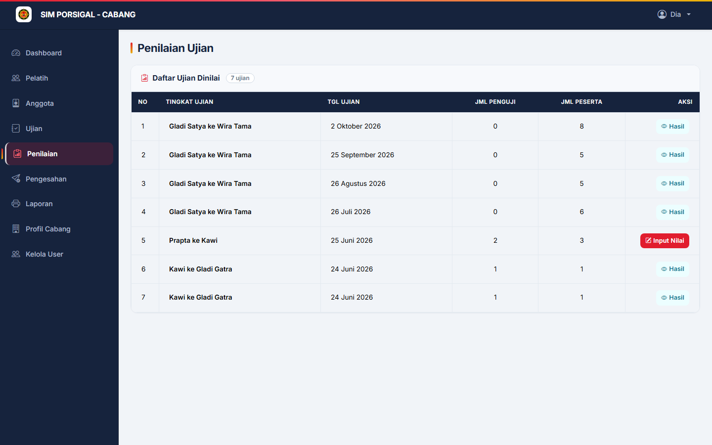
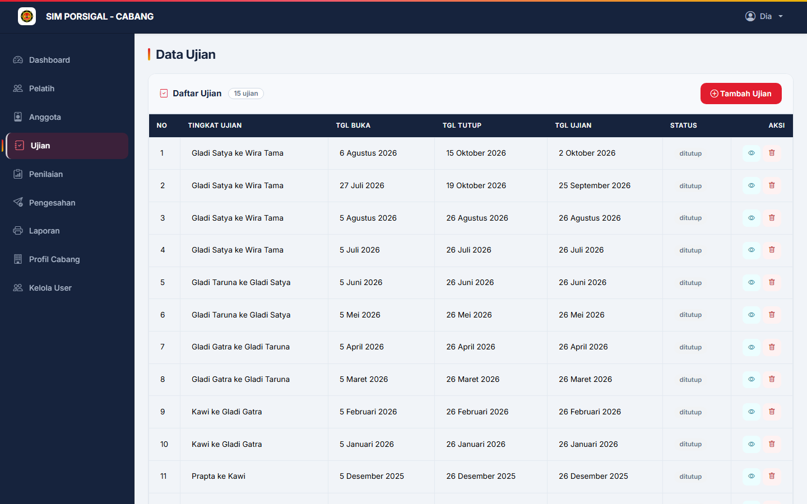
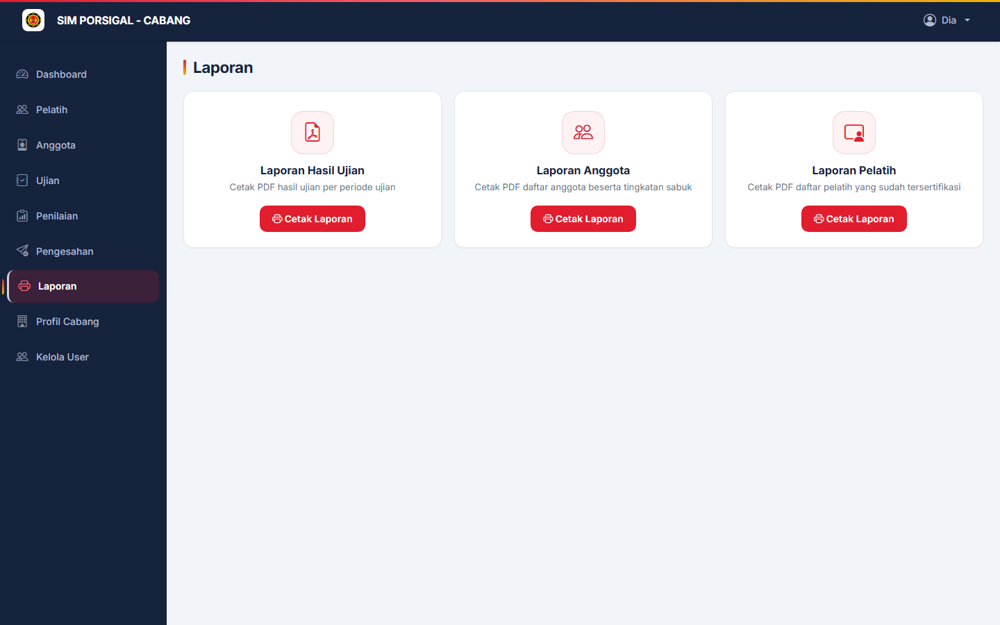

# SIM PORSIGAL (SIMPOR)

Sistem Informasi Manajemen PORSIGAL — aplikasi pendataan anggota dan pelatih,
pelaksanaan ujian kenaikan tingkat, penilaian, pengesahan, sampai cetak laporan.

Aplikasi web PHP + MySQL dengan dua peran pengguna: **Admin Cabang** dan
**Admin Pusat**.



---

## Fitur

**Admin Cabang**

- Dashboard berisi grafik tren ujian, komposisi status peserta, sebaran sabuk,
  dan distribusi nilai.
- Data Pelatih — tambah, ubah, hapus.
- Data Anggota — tambah, ubah, hapus; status warga/non-warga dihitung otomatis
  dari tingkatan sabuk.
- Ujian — membuat jadwal ujian, menentukan peserta, dan memantau hasil.
- Penilaian — unggah nilai lewat Excel, proses, unduh rekap Excel.
- Pengesahan — mengirim hasil ujian ke pusat dan memantau statusnya.
- Laporan — cetak data anggota, pelatih, dan hasil ujian.
- Profil Cabang dan Kelola User.

**Admin Pusat**

- Dashboard ringkasan lintas cabang.
- Inbox pengesahan — meninjau, menyetujui, atau menolak hasil ujian.
- Profil Pusat dan Kelola User.

| Data Anggota | Penilaian |
|---|---|
|  |  |

| Data Ujian | Laporan |
|---|---|
|  |  |

---

## Teknologi

- **PHP 8.1** (prosedural, `mysqli`)
- **MySQL 8**
- **Bootstrap 5.3** + Bootstrap Icons
- **ApexCharts** untuk grafik dashboard
- **PhpSpreadsheet** untuk impor/ekspor Excel
- **Dompdf** untuk cetak laporan PDF
- Tanpa framework — sengaja dijaga sederhana agar mudah dipelajari

---

## Struktur Folder

```
SIMPOR/
├── admin/                 area Admin Cabang
│   ├── anggota/           CRUD anggota
│   ├── pelatih/           CRUD pelatih
│   ├── ujian/             jadwal & peserta ujian
│   ├── penilaian/         impor nilai, proses, ekspor
│   ├── pengesahan/        kirim hasil ke pusat
│   ├── laporan/           cetak anggota/pelatih/hasil
│   ├── profil/            profil cabang
│   ├── user/              kelola akun admin
│   └── dashboard.php
├── pusat/                 area Admin Pusat
│   ├── inbox.php          daftar pengesahan masuk
│   ├── detail.php         tinjau & setujui
│   ├── profil/            profil pusat
│   ├── user/              kelola akun pusat
│   └── dashboard.php
├── includes/              config, sesi, sidebar, fungsi bersama
├── assets/                CSS, JS, gambar
├── docs/                  skema DB, data demo, panduan
├── uploads/               berkas unggahan (tidak di-commit)
├── index.php              redirect ke login
└── login.php
```

---

## Cara Menjalankan

Butuh PHP 8.1+, MySQL 8, dan Composer. Contoh di Laragon:

1. **Salin proyek** ke `D:\laragon\www\SIMPOR`.

2. **Pasang dependensi**

   ```powershell
   composer install
   ```

3. **Buat konfigurasi database**

   ```powershell
   Copy-Item includes/config.example.php includes/config.php
   ```

   Lalu isi `$user`, `$pass`, dan `$db` sesuai MySQL lokal.

4. **Buat database dan impor skema**

   ```powershell
   mysql -u root -e "CREATE DATABASE simpor CHARACTER SET utf8mb4 COLLATE utf8mb4_0900_ai_ci;"
   mysql -u root simpor < docs/skema-database.sql
   ```

5. **Buat akun admin pertama** (dijalankan dari terminal)

   ```powershell
   php docs/buat-admin.php admin "PasswordBaru123" "Administrator" admin
   ```

6. **Buka aplikasi** di `http://localhost/SIMPOR/` lalu login.

7. **(Opsional) Isi data demo** agar grafik dashboard terisi:

   ```powershell
   mysql -u root simpor < docs/seed-contoh.sql
   ```

   Hapus lagi dengan `docs/CARA-HAPUS-DATA-CONTOH.sql`.

---

## Keamanan

Password disimpan dengan `password_hash()` (bcrypt). Hash MD5 lama tetap bisa
login dan otomatis dinaikkan ke bcrypt. Cookie sesi `HttpOnly` + `SameSite`,
ID sesi diperbarui saat login, dan percobaan login dibatasi.

Baca **[SECURITY.md](SECURITY.md)** sebelum mengunggah atau memasang aplikasi
ini — di situ dijelaskan file mana yang tidak boleh ikut ke GitHub dan
bagaimana memeriksanya.

---

## Catatan

- Data pada screenshot dan `docs/seed-contoh.sql` adalah **data sintetis**
  untuk keperluan demo, bukan data anggota sungguhan.
- Repositori ini berisi kode saja. Database dan berkas unggahan pengguna tidak
  disertakan.
